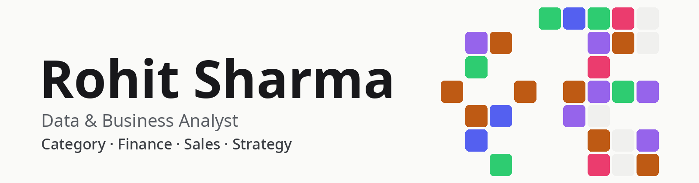

I'm a data analyst from India working across D2C, automotive and manufacturing - category, finance and sales data analysis, business analytics and strategy - turning raw data into business decisions with SQL, Python and BI tools.

## About me

- **Currently:** Data Analyst at NatHabit (D2C) - marketshare reporting automation, category P&L and unit economics (CAC, ROAS, CM1-CM3), cohort & retention analysis, marketplace spend mix, finance closures and revenue reconciliation
- **Previously:** Data Analyst, Sales & Operations at Mahindra & Mahindra - full-funnel sales conversion, demand and customer-satisfaction (CSI/SSI) analysis supporting regional strategy
- **Earlier:** Data Analyst at Derewala Industries - manufacturing analytics and SQL-driven tracking dashboards, cutting rework and rejection rates
- **Education:** Master of Economics (University of Rajasthan), BBA

## Stack

## Featured projects

| Project | What it does |
| --- | --- |
| [**cs-dashboard**](https://github.com/darohitsharma/cs-dashboard) · [Live demo](https://darohitsharma.github.io/cs-dashboard/) | Standalone, read-only browser dashboard for customer-query data kept in a Google Sheet (Vite, vanilla JS, Chart.js; no backend, no tracking). The demo signs in with Google and reads the viewer's own sheet - real data needs access to the private sheet. |
| **CS Query Intent & D2C Search Query Analysis** (internal work project) | Rule-based 3-tier intent taxonomy classifying customer-service tickets and D2C search queries (5 primary, 13 secondary intents), mapped to 40+ product categories; Pareto analysis isolated the top 75% of customer concerns and surfaced 9 category-expansion opportunities (Hair Color, Sunscreen, Serum). The classified data is what the cs-dashboard above visualizes. |
| **Inventory Replenishment & Variant Movement Analysis - TTR Model** (internal work project) | Time-to-Replenish model estimating SKU-level replenishment timing from sales velocity, inventory days and stockout rate, cutting stockout risk; variant-switching analysis informs assortment planning and pricing strategy. |
| [**Sql-data-warehouse-project**](https://github.com/darohitsharma/Sql-data-warehouse-project) | SQL Server data warehouse consolidating ERP and CRM sales data, with data-quality cleaning and SQL analytics on customer behavior, product performance and sales trends. |
| [**Insurance-premium_prediction-Model**](https://github.com/darohitsharma/Insurance-premium_prediction-Model) | Regression models (linear, SVR, random forest, gradient boosting) predicting health insurance premiums on a Kaggle dataset, with a Streamlit web app. |

## Reach me

